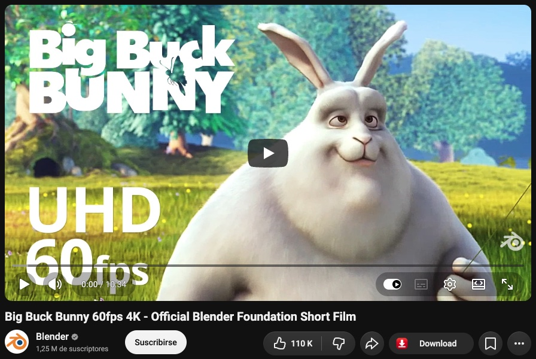
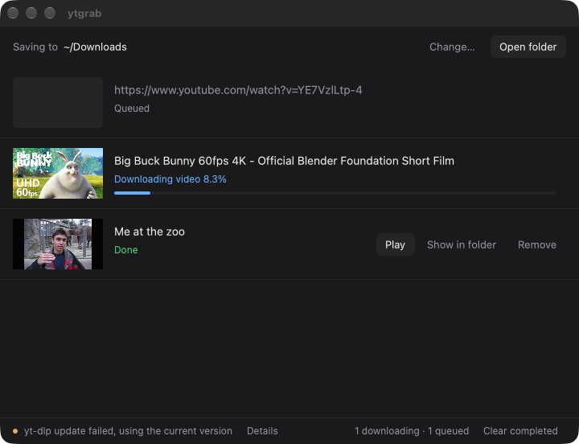

<div align="center">


# ytgrab

**One click under a YouTube video, and it lands in your Downloads at the best quality.**

[](https://github.com/gecm0/ytgrab/releases/latest)


[](LICENSE)

[**Download for Windows**](https://github.com/gecm0/ytgrab/releases/latest/download/ytgrab-windows-x64.zip) ·
[**Download for macOS**](https://github.com/gecm0/ytgrab/releases/latest/download/ytgrab-macos-arm64.tar.gz) ·
[**Chrome extension**](https://github.com/gecm0/ytgrab/releases/latest/download/ytgrab-extension.zip)

</div>

<p align="center">
  
  
</p>

## What it does

- **A Download button on YouTube**, right next to Like and Share. The toolbar icon works too.
- **Always the best quality**, always the same format: VP9 video + Opus audio in an MKV file. If a video has no Opus audio, its best audio is converted to Opus (160 kbps); the video is never re-encoded.
- **A small queue app** with thumbnails, progress, Play, Show in folder and Retry.
- **Works with your login.** The extension passes your YouTube cookies, so videos that need you to be signed in work too.
- **Stays up to date.** yt-dlp updates itself every time the app starts.

## Install

### Windows

1. Download [`ytgrab-windows-x64.zip`](https://github.com/gecm0/ytgrab/releases/latest/download/ytgrab-windows-x64.zip) and unzip it anywhere.
2. Run `ytgrab.exe`. The build is not signed, so SmartScreen may warn you: **More info → Run anyway**.

Everything it needs (yt-dlp, ffmpeg, deno) is already in the `bin\` folder.

### macOS (Apple Silicon)

```sh
brew install yt-dlp deno ffmpeg
tar -xzf ytgrab-macos-arm64.tar.gz
xattr -c ytgrab   # the binary is not signed; this clears the download quarantine
./ytgrab
```

### Chrome extension

1. Download [`ytgrab-extension.zip`](https://github.com/gecm0/ytgrab/releases/latest/download/ytgrab-extension.zip) and unzip it.
2. Open `chrome://extensions`, turn on **Developer mode**, click **Load unpacked** and pick the unzipped folder.

## Use it

Keep the app open, go to a YouTube video and click **Download**. The button tells you what happened:

| Button | Toolbar badge | Meaning |
|---|---|---|
| Queued | `OK` | The app got it |
| App closed | `OFF` | Start the app first |
| Not a video | `YT?` | You are not on a video page |
| Error | `ERR` | Something else failed |

No extension? Copy a YouTube link and press **Add from clipboard** (or Cmd/Ctrl+V) in the app. Pasted links reuse the cookies of the extension's latest download in this session, kept in memory only; before that they download signed out, so age-restricted, private and members-only videos fail.

Files go to `~/Downloads` by default. Pick another folder with **Change…** in the app.

## Good to know

- **Videos without VP9 video fail on purpose**, so every file uses the same codecs.
- **Unlisted videos work** like public ones. **Private videos** only work if the account you are signed in with was given access. **Members-only videos** only work if that account is a member of the channel at the required level.
- **Heavy use with a logged-in account** can get that account rate-limited or flagged by YouTube.
- **Cookies never stay on disk.** They are written to a temp file per download and deleted right after.
- **The app only listens on `127.0.0.1:47321`** and only accepts requests from this extension's ID.
- The folder setting lives in `%APPDATA%\ytgrab\settings.json` on Windows and `~/.config/ytgrab/settings.json` elsewhere.
- Thumbnails come from `i.ytimg.com` and are cached in the temp folder until the next start.

## Development

The app is Rust ([gpui](https://www.gpui.rs) + tiny_http), all in `app/src/main.rs`. The extension is plain MV3 JavaScript in `extension/`.

### Build

```sh
cd app
cargo build --release
```

Windows needs the Rust MSVC toolchain (Visual Studio Build Tools + Windows SDK); `build.rs` embeds `assets/icon.ico` into the exe there. macOS uses gpui's `runtime_shaders`, so no Metal toolchain is needed.

The app looks for its tools in `bin/` next to the executable and falls back to `PATH`. The Windows layout:

```
ytgrab\
  ytgrab.exe
  bin\
    yt-dlp.exe     https://github.com/yt-dlp/yt-dlp/releases/latest/download/yt-dlp.exe
    deno.exe       https://github.com/denoland/deno/releases (deno-x86_64-pc-windows-msvc.zip)
    ffmpeg.exe     https://github.com/yt-dlp/FFmpeg-Builds/releases (ffmpeg-master-latest-win64-gpl.zip)
    ffprobe.exe    same zip as ffmpeg
```

To load the extension from source, use **Load unpacked** on `extension/`.

### Tests

```sh
cd app && cargo test
bun extension/cookies.test.js
```

### Release

Push a tag (`git tag v0.2.0 && git push origin v0.2.0`). `.github/workflows/release.yml` builds on GitHub-hosted runners and publishes a GitHub Release with:

- `ytgrab-windows-x64.zip`: `ytgrab.exe` plus `bin/` with yt-dlp, deno, ffmpeg and ffprobe (latest at build time).
- `ytgrab-macos-arm64.tar.gz`: the bare, unsigned binary.
- `ytgrab-extension.zip`: the `extension/` folder without tests.

The Windows and macOS binaries are rebuilt only if `app/` or the workflow changed since the previous tag. Otherwise they are copied from that tag's release, so don't delete old releases.

### Extension ID

The `"key"` in `manifest.json` pins the extension ID to `nmiolemafidjgnibgjgjooceilfpdoaf` wherever it is loaded from. The app accepts requests only with that `Origin`. If you change the key, update `EXTENSION_ORIGIN` in `app/src/main.rs`. That Origin check is the only auth, which is enough while the server can only queue YouTube URLs; add real auth if it ever does more.

### Icon

`assets/icon.png` (generated with Codex) is the source. `extension/icons/*.png` and `assets/icon.ico` are resized from it.

## Disclaimer

ytgrab is not affiliated with, endorsed by or sponsored by YouTube or Google. It is meant for videos you own, videos under a free license, or videos you have permission to download. You are responsible for how you use it, including YouTube's Terms of Service and copyright law where you live.

## License

[MIT](LICENSE). The Windows release also ships third-party tools under their own licenses: [yt-dlp](https://github.com/yt-dlp/yt-dlp) (Unlicense), [deno](https://github.com/denoland/deno) (MIT) and [FFmpeg](https://github.com/yt-dlp/FFmpeg-Builds) (GPL, source available from that link).
